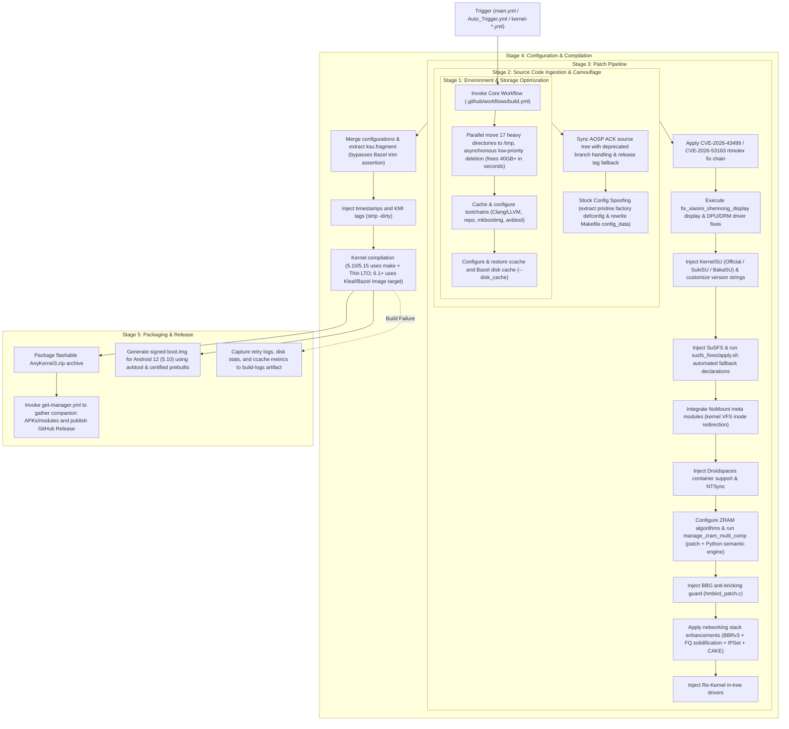

# GKI KernelSU SUSFS Advanced Custom Kernel Build System

**Automated Android Generic Kernel Image (GKI) Pipeline | Deep Integration of KernelSU + SuSFS + Exclusive ZRAM Multi-Comp + Xiaomi 14 Pro Screen Fix + Security Guards**

English | [**简体中文**](README.md)

---

## ⚠️ Critical Verification Status & Risk Notice (Must Read)

> [!CAUTION]
> **Essential Testing Status Warning:**
> - **The overwhelming majority of exclusive custom features, low-level enhancement patches (such as ZRAM Multi-Comp recompression, the standalone MMD daemon, Xiaomi 14 Pro display flickering fixes, NoMount, and networking scheduler tuning), and build fault-tolerance fixes in this repository have ONLY been thoroughly compiled and verified on `Android 14 (6.1)` and `Android 12 (5.10)` kernel branches.**
> - For other kernel versions (`Android 13 (5.15)`, `Android 15 (6.6)`, `Android 16 (6.12)`, etc.), due to significant upstream codebase divergence, deprecated kernel symbols, and structural refactoring, **it is currently UNKNOWN whether they will successfully compile or boot without issue.**
> - When attempting to build or flash kernels for untested branches, you must be prepared to resolve compilation conflicts independently. **ALWAYS create a full backup of your current `boot` / `init_boot` partitions via fastboot or custom recovery before flashing any custom kernel!**

---

## 📌 Upstream References & Credits

This project builds upon significant community contributions:

- **Workflow Foundation**: [zzh20188/GKI_KernelSU_SUSFS](https://github.com/zzh20188/GKI_KernelSU_SUSFS) (Original automated CI project)
- **Official KernelSU**: [tiann/KernelSU](https://github.com/tiann/KernelSU) (Kernel-based root solution)
- **SuSFS Camouflage Framework**: [simonpunk/susfs4ksu](https://gitlab.com/simonpunk/susfs4ksu) (Kernel-level root & mount evasion system)
- **Community KernelSU Variants**:
  - [SukiX-Team/SukiSU](https://github.com/SukiX-Team/SukiSU) & [SukiSU-Ultra](https://github.com/SukiSU-Ultra/SukiSU-Ultra)
  - BakaSU Variant
- **NoMount Meta Modules**: [maxsteeel/nomount](https://github.com/maxsteeel/nomount)
- **Anti-Bricking Protection (BBG)**: `hmbird_patch.c` block-device partition write interception
- **Packaging Engine**: [osm0sis/AnyKernel3](https://github.com/osm0sis/AnyKernel3)
- **Container Environment**: [ravindu644/Droidspaces-OSS](https://github.com/ravindu644/Droidspaces-OSS)
- **Linux Upstream Security Patches**: GhostLock vulnerability research team & upstream Linux rtmutex fixes

---

## 🚀 Exclusive Innovations & Enhancements in This Repository

This repository (`Aut520/GKI_KernelSU_SUSFS`) introduces substantial independent innovations, kernel fixes, and CI robustness enhancements:

### 1. [Exclusive] ZRAM Multi-Comp (Multi-Stream Recompression) & Standalone Rust MMD Daemon
- **All-Kernel Multi-Comp Backport**: While upstream kernels only natively support Multi-Comp on 6.6+, this project provides full backport patch trees enabling Multi-Comp on 5.10, 5.15, and 6.1.
- **Dual-Engine Precision Patcher (`scripts/manage_zram_multi_comp.py`)**: Splicing patches across fluctuating minor revisions (such as 6.1.140 vs 6.1.176) often fails. We built a **Python AST / Semantic Analysis Engine** that automatically performs semantic-level code insertion when `git apply` encounters offset conflicts, achieving 100% injection success.
- **Kernel-Level Memory Safety Fixes**:
  - Eliminates `EINVAL` crashes by skipping `ZRAM_SAME/WB/UNDER_WB` pages inside `recompress_store`;
  - Clears `INCOMPRESSIBLE` flags inside `zram_free_page` to prevent `WARN_ON_ONCE` kernel warnings;
  - Clamps ZRAM capacity to a maximum of 3/4 of physical RAM aligned to page boundaries (`PAGE_ALIGN`).
- **Independent Standalone Rust `mmd` Daemon (`mmd/`)**:
  - Stripped from Android 17+ `system/memory/mmd`, rewritten in Rust as a **zero-dependency, zero-Binder, zero-Java pure native binary** (~400KB size, <1.5MB RAM, 0% CPU);
  - Preserves Google's exponential decay cold page tracking and sleep duration compensation algorithms;
  - Supports CLI status inspections (`-s`), manual triggers (`-t`), and background daemon monitoring (`-d`).

### 2. [Exclusive] Xiaomi 14 Pro (SM8650) High-Kernel Display Flickering Fix
For Xiaomi 14 Pro (`shennong`, Snapdragon 8 Gen 3) running 6.1.140+ (e.g. 6.1.176 / 6.1.177) kernels with vendor modules compiled against 6.1.138, we implemented an automated patching suite (`scripts/fix_xiaomi_shennong_display.py`):
- Restores safe wait sequences in `dpu_encoder_phys_cmd` to eradicate dual-DSI command mode tearing and high-frequency flicker;
- Relaxes DRM atomic modeset clone validations to prevent `-EINVAL` dropouts;
- Restores plane dimension alignment calculations in `drm_fourcc.h`;
- Reinstates removed `pm_domain` and `cpufreq` Vendor Hooks;
- Fixes CPU Idle timer wake-up jitter to prevent VSYNC latency micro-stutters.

### 3. Networking Stack Optimization & FQ (Fair Queueing) Solidification
- Solidifies the default queuing discipline to **FQ (Fair Queueing)** (`CONFIG_NET_SCH_DEFAULT=y`, `CONFIG_DEFAULT_FQ=y`), the canonical companion for Google BBRv3 to ensure microsecond-level packet pacing;
- Backports required sysctl APIs (`proc_dou8vec_minmax`) for kernel 5.10;
- Integrates IPSet, CAKE/FQ_CODEL, TTL spoofing, and CIFS file sharing.

### 4. Dedicated 5.10 & 6.1 Build Reliability Fixes
- **Thin-LTO Restoration on 5.10**: Upstream removed forced Thin-LTO. Full LTO on 5.10 rapidly exhausts runner memory, triggering OOM Killer (exit code 137). We strictly locked `LTO=thin` for 5.10 in `build.yml`;
- **5.10 `preinit.c` Missing `close_fd` Fix**: Fixed compilation errors in SUSFS initialization;
- **`fs/namespace.c` Automatic Fallback**: Automatically supplements missing forward declarations when official SUSFS patches fail on Hunk #1.

### 5. Decoupled CI Restrictions & Production-Ready Defaults
- Removed all hardcoded repository ownership restrictions, enabling forked repos to execute workflows and publish releases independently;
- Pointed legacy resource downloads to this repository (`Aut520/GKI_KernelSU_SUSFS`);
- **Optimized Defaults**:
  - `kernelsu_variant: Official` (default to official stable KernelSU);
  - `release_type: Release` (automatically publish GitHub Releases);
  - Enabled by default: `use_bbg`, `use_zram`, `use_nomount`, `use_networking`, and `cve_2026_43499_patch`.

---

## 🏗️ Comprehensive GitHub Actions Build Architecture

---

## 🛠️ Feature Matrix

| Module | Default | Role & Architectural Mechanism |
| :--- | :---: | :--- |
| **KernelSU (Official)** | **Enabled** | Official in-kernel root privilege management. |
| **SuSFS Camouflage** | **Enabled** | Hooks VFS path traversals and overrides `openat`/`stat` to hide root presence. |
| **ZRAM Multi-Comp** | **Enabled** | Multi-stream dual algorithm (LZ4 + ZSTD) memory recompression. **Tested on 6.1 & 5.10**. |
| **Standalone Rust MMD** | **Companion** | Lightweight, framework-free daemon in Rust for intelligent idle recompression. |
| **Xiaomi 14 Pro Fix** | Optional | Resolves display tearing and flickering on 6.1.140+ kernels with proprietary SM8650 vendor drivers. |
| **BBG Anti-Bricking** | **Enabled** | Block-device layer write filtering for `boot`, `super`, `userdata`, and modem partitions. |
| **NoMount Meta Modules** | **Enabled** | Injects root modules via VFS inode redirection without visible mount entries. |
| **Networking (FQ+BBRv3)**| **Enabled** | Solidified FQ packet pacing with BBRv3, IPSet, and CAKE. |
| **GhostLock Fix** | **Enabled** | Mitigates CVE-2026-43499/53163 privilege escalation in `kernel/locking/rtmutex.c`. |
| **Stock Config Spoofing**| Automatic | Camouflages `/proc/config.gz` against userspace root inspection tools. |

---

## 📖 Flashing Guide

1. Verify that your device runs a standard Google GKI kernel (`uname -r` in terminal);
2. Match the kernel zip to your Android and kernel version (e.g. choose 6.1 for `6.1.xxx`, 5.10 for `5.10.xxx`);
3. **MANDATORY: Back up your `boot` and `init_boot` partitions via fastboot or custom recovery before flashing!**
4. Flash the resulting `AnyKernel3-*.zip` via custom recovery (TWRP/OrangeFox) or Kernel Flasher.

---

## 📄 License

Kernel patches and modifications are released under the [GNU General Public License v2.0](LICENSE). Upstream components belong to their respective copyright holders.
