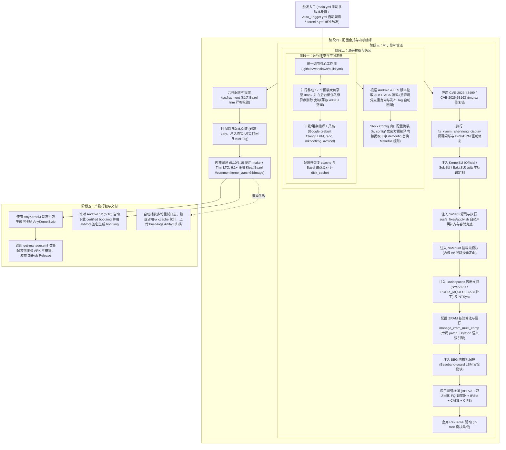

# GKI KernelSU SUSFS 高级定制内核构建系统

**自动化构建 Android 通用内核 (GKI) | 深度集成 KernelSU + SuSFS + 独家 ZRAM Multi-Comp + 小米14Pro驱动修复 + 安全防护**

[**English**](README-EN.md) | **简体中文**

---

## ⚠️ 核心兼容性与测试状态声明（必读）

> [!CAUTION]
> **极其重要的测试状态与风险警告：**
> - 本项目中的**绝大多数定制功能、底层增强补丁（如 ZRAM Multi-Comp 二次重压缩、独立 MMD 守护进程、小米 14 Pro 屏幕闪烁修复、NoMount、网络增强调度）以及编译容错修复**，目前**仅在 `Android 14 (6.1)` 和 `Android 12 (5.10)` 两个内核分支上经过了完整的编译验证与真机运行测试**！
> - 对于其它内核版本（如 `Android 13 (5.15)`、`Android 15 (6.6)`、`Android 16 (6.12)` 等），由于 Google 上游代码树结构演进巨大、内核符号频繁废弃与重构，**目前处于“未知是否能构建成功或正常开机”的状态**。
> - 若尝试在未经充分测试的内核分支上编译或刷入，请做好自行排查编译错误的心理准备，**在刷入任何自编译内核前，必须提前通过 fastboot 或第三方 Recovery 完整备份当前设备的 `boot` / `init_boot` 分区**！

---

## 📌 上游项目与开源致谢 (Upstream References)

本项目立足于 Android 开源社区多位优秀开发者的成果，核心上游项目包括：

- **自动化构建工作流上游**：[zzh20188/GKI_KernelSU_SUSFS](https://github.com/zzh20188/GKI_KernelSU_SUSFS)（原始 CI 构建工程）
- **官方 KernelSU 方案**：[tiann/KernelSU](https://github.com/tiann/KernelSU)（内核级 Root 访问授权控制）
- **SuSFS 深度隐蔽系统**：[simonpunk/susfs4ksu](https://gitlab.com/simonpunk/susfs4ksu)（内核级反检测伪装文件系统）
- **社区 KernelSU 变体**：
  - [SukiX-Team/SukiSU](https://github.com/SukiX-Team/SukiSU) 与 [SukiSU-Ultra](https://github.com/SukiSU-Ultra/SukiSU-Ultra)
  - BakaSU 变体
- **NoMount 挂载元模块**：[maxsteeel/nomount](https://github.com/maxsteeel/nomount)
- **基带与系统防格机保护 (BBG)**：[vc-teahouse/Baseband-guard](https://github.com/vc-teahouse/Baseband-guard)（LSM 模块级底层写保护拦截，阻止恶意抹除基带与关键分区）
- **一加 8E 处理器支持驱动**：`hmbird_patch.c`（针对特定 SoC 的驱动与符号支持）
- **内核卡刷包引擎**：[osm0sis/AnyKernel3](https://github.com/osm0sis/AnyKernel3)
- **容器环境与驱动**：[ravindu644/Droidspaces-OSS](https://github.com/ravindu644/Droidspaces-OSS)
- **Linux 上游安全补丁**：GhostLock 漏洞研究团队及 Linux 官方 rtmutex 修复链

---

## 🚀 本仓库专属新增功能与深度改造 (What We Added & Changed)

相比上游基础仓库，本仓库（`Aut520/GKI_KernelSU_SUSFS`）进行了大量的独家功能开发、性能重构与工程修复：

### 1. 【独家】ZRAM Multi-Comp (多流二次重压缩系统) & 独立 Rust MMD 守护进程
- **全内核版本 Multi-Comp 适配**：上游内核仅 6.6+ 原生支持 Multi-Comp，低版本（5.10、5.15、6.1）缺乏支持。本项目开发了全套补丁栈，使 5.10~6.12+ 全系内核均可启用多压缩流。
- **【双保险】语义修补引擎**（`scripts/manage_zram_multi_comp.py`）：针对不同子版本（如 6.1.140 到 6.1.176）源码漂移导致的 patch 冲突，内置 **Python AST/语义分析引擎**，在 `git apply` 冲突时自动进行语义级源码精准补全，实现 100% 注入成功率。
- **内核底层内存 Bug 深度根除**：
  - 修复 `recompress_store` 误对 `ZRAM_SAME/WB/UNDER_WB` 页面操作导致返回 `-EINVAL` 的缺陷；
  - 修复 `zram_free_page` 中未清理不可压缩标志导致的 `WARN_ON_ONCE` 内核警告；
  - 引入智能容量上限约束（Clamp），锁定 ZRAM 最大不超过物理内存 3/4 并页对齐。
- **独立轻量级 Rust `mmd` 守护进程（位于 `mmd/`）**：
  - 从 Android 17+ 原厂 `system/memory/mmd` 剥离解耦，用 Rust 编写为**零依赖、零 Binder、零 Java 框架的纯 Native 单文件二进制**（体积仅 ~400KB，内存占用 <1.5MB，CPU 0%）；
  - 完整继承官方指数衰减冷页判定与休眠时间补偿算法，支持 CLI 即时诊断（`-s`）、手动触发重压（`-t`）与后台守护调度（`-d`）。

### 2. 【独家】小米 14 Pro（`shennong`，SM8650）屏幕闪烁驱动修复系统
针对高通骁龙 8 Gen 3 平台的小米 14 Pro 在升级到 6.1.140+（如 6.1.176）GKI 内核后，原厂闭源 vendor 驱动与新内核冲突导致的屏幕闪烁、黑屏与丢帧问题，开发了自动化补全脚本（`scripts/fix_xiaomi_shennong_display.py`）：
- 修复 DPU 物理编码器提交等待时序（`dpu_encoder_phys_cmd`），杜绝双 DSI 命令模式下的帧撕裂闪烁；
- 放宽 DRM Atomic Modeset 克隆检查（`drm_atomic_check_valid_clones`），防止 Modeset 失败抛出 `-EINVAL` 导致丢帧；
- 还原 DRM 图层尺寸对齐计算（`drm_format_info_plane_width/height`）；
- 恢复被 Google ACK 移除的 `pm_domain` 与 `cpufreq` Vendor Hooks 回调；
- 修复 CPU Idle 定时器唤醒防护，防止 VSYNC 抖动与背光平滑插值微闪。

### 3. 网络增强进阶与默认队列调度器固化为 FQ (Fair Queueing)
- 结合 BBRv3 拥塞控制算法，将内核默认队列调度器（Qdisc）固化为 **FQ (Fair Queueing)**（`CONFIG_NET_SCH_DEFAULT=y`, `CONFIG_DEFAULT_FQ=y`），达成低延迟与高吞吐的黄金组合；
- 针对 5.10 内核特别应用 sysctl 前置补丁（`sysctl_add_proc_dou8vec_minmax` 等）；
- 全面集成 IPSet 全家桶、CAKE/FQ_CODEL 流量整形、TTL 伪装与 CIFS 协议支持。

### 4. 5.10 与 6.1 专属编译稳定性修复
- **5.10 Thin-LTO 内存保护**：上游移除了强制 Thin LTO，导致 5.10 内核使用 Full LTO 链接超大 `vmlinux.o` 时因内存暴涨触发 GitHub Actions OOM (SIGKILL) 或超时中断。本项目在 `build.yml` 中针对 5.10 精准恢复 `LTO=thin`，保障编译稳定通过；
- **5.10 `preinit.c` 缺少 `close_fd` 修复**：在 `scripts/susfs_fixes/apply.sh` 中修复了 5.10 下 SUSFS 编译缺少符号声明的问题；
- **`fs/namespace.c` 补丁缺失声明自动兜底**：自动校准并补齐官方补丁在部分 ACK 子版本上的 Hunk #1 声明缺失。

### 5. 解除原作者分发限制与开箱即用默认配置
- 彻底移除了 `main.yml` 和 `Auto_Trigger.yml` 中只允许原作者运行的限制，支持任何 Fork 仓库全功能自主调度；
- 修正所有写死上游地址的资源下载链接，全面重定向至本仓库（`Aut520/GKI_KernelSU_SUSFS`）；
- **默认配置全面优化**：
  - 默认 KernelSU 变体设为官方原版 **`Official`**；
  - 默认发布类型设为 **`Release`**；
  - 默认开启 **`use_bbg`**（防格机）、**`use_zram`**（ZRAM增强）、**`use_nomount`**（免挂载元模块）、**`use_networking`**（网络增强）与 **`cve_2026_43499_patch`**（GhostLock修复）。

---

## 🏗️ GitHub Actions 自动化构建全流程深度剖析 (Build Pipeline)

整个内核编译与打包流程高度模块化，各环节严密咬合，架构图如下：

### 关键步骤技术解析：
1. **秒级磁盘释放（`safe_mv`）**：
   Runner 预装了大量 .NET、Android SDK、GHC 等体积庞大的工具。工作流通过并行将 17 个目录秒级 `mv` 到 `/tmp/.background_trash`，然后启动 `ionice -c 3 nice -n 19` 在后台异步删除，不消耗构建等待时间即可腾出 40GB+ 空间。
2. **ACK 源码拉取健壮性**：
   针对 Google AOSP 服务器偶发断连与限流，脚本使用带重试的 `repo` 工具；当月度分支被 Google 废弃移入 `deprecated/` 或彻底删除时，脚本自动通过 `git ls-remote` 回退定位到最高编号的官方发布 Tag（`refs/tags/<branch>_r*`），保证源码 100% 同步成功。
3. **出厂配置伪装（Stock Config Spoofing）**：
   在编译前，从预设文件或从 Google 官方预编译内核使用 `extract-ikconfig` 提取未受修改的原厂出厂配置覆盖 `stock_defconfig`，修改 `kernel/Makefile` 将 `config_data` 规则指向它。编译生成的内核在真机上读取 `/proc/config.gz` 时完全呈现官方未 Root 状态，完美绕过读取配置的检测手段。
4. **编译引擎智能分派**：
   - **5.10 / 5.15**：基于经典 Makefile 体系构建，针对 5.10 强制执行 `LTO=thin` 防止内存溢出；
   - **6.1 / 6.6 / 6.12**：基于 Google 新一代 **Kleaf / Bazel** 构建系统。工作流自动将所有新增的 defconfig 变更提取为 `ksu.fragment`，通过 `--defconfig_fragment` 参数传入，完美绕过 Bazel 严格的配置修剪（trim）一致性断言。
5. **智能重试与日志抓取**：
   调用 `nick-fields/retry@v4` 提供单次 30 分钟、最多 3 次超时自动重试。若最终失败，会自动打包各次尝试日志、磁盘空间及 ccache 命中率生成 `build-logs` 压缩包供复盘排查。

---

## 🛠️ 核心功能矩阵与技术参数

| 功能模块 | 默认状态 | 核心作用 | 适用内核与技术原理 |
| :--- | :---: | :--- | :--- |
| **KernelSU (Official)** | **默认开启** | 官方内核级授权管理 | 全版本适用；内核态系统调用拦截与 su 提权控制。 |
| **SuSFS 隐蔽系统** | **默认开启** | 深度隐藏 Root 与自定义挂载 | 全版本；VFS 核心路径拦截、重载 `openat` / `stat` 伪装敏感目录。 |
| **ZRAM Multi-Comp** | **默认开启** | 多流并发二次重压缩，大幅提升后台留存 | **重点验证于 6.1 / 5.10**；ZSTD+LZ4 双流并发，消除锁竞争。 |
| **独立 Rust MMD** | **配套工具** | 独立于系统框架的原生内存守护进程 | **全 Android 版本通用**；体积 400KB，内存 <1.5MB，纯 Native 常驻。 |
| **小米14Pro屏闪修复** | 可选开关 | 修复 6.1.176 内核屏幕微闪与丢帧 | **写死限定针对 6.1.176 内核**；重构 DPU 时序等待、放宽 Modeset 克隆并补全 Vendor Hook 真实调用点（非 6.1.176 自动安全跳过）。 |
| **BBG 防格机机制** | **默认开启** | 拦截恶意模块破坏清空底层基带与关键分区 | 全版本；集成 Baseband-guard LSM 安全模块，从内核安全子系统拦截非法格式化与擦写。 |
| **一加8E处理器驱动** | 可选开关 | 提供一加 8E / 特殊 SoC 驱动与符号支持 | 注入 `hmbird_patch.c` 并加入构建。 |
| **NoMount 元模块** | **默认开启** | 无需创建用户态挂载点即可加载模块 | 全版本；内核 `fs/` 层 inode 重定向，绕过 mount 表检测。 |
| **网络增强 (FQ+BBRv3)** | **默认开启** | 提升弱网吞吐、降低延迟，抑制缓冲膨胀 | 全版本（5.10 额外打补丁）；固化 FQ 调度器，集成 IPSet/CAKE。 |
| **GhostLock 安全修复** | **默认开启** | 修补 CVE-2026-43499/53163 提权漏洞 | 全版本；修复 `kernel/locking/rtmutex.c` 优先级继承死锁与竞争。 |
| **Stock Config 伪装** | 自动触发 | 隐藏 `/proc/config.gz` 中的 Root 编译选项 | 全版本；链接阶段替换内置配置为官方原生干净配置。 |

---

## 📖 刷入与使用指南

### 1. 刷入前准备
- 确认设备出厂搭载 Android 12 或以上系统（支持 Google GKI 架构）；
- 在终端执行 `uname -r` 检查当前设备内核版本（例如 `6.1.176-android14-...` 选择 6.1 内核刷机包，`5.10.xxx` 选择 5.10 内核刷机包）；
- **【强制要求】使用第三方 Recovery 或通过 fastboot 完整备份设备的 `boot` / `init_boot` 分区！**

### 2. 刷入方式
- **方式一（Recovery 卡刷）**：在 TWRP / OrangeFox 等第三方 Recovery 界面直接安装生成的 `AnyKernel3-*.zip`；
- **方式二（Kernel Flasher）**：在已有 Root 的手机上安装 [Kernel Flasher](https://github.com/capntrips/KernelFlasher) 应用，导入 AnyKernel3 zip 包完成在线刷入；
- **方式三（解包提取镜像）**：解压 AnyKernel3 压缩包提取其中的 `Image` 原始内核镜像，通过 fastboot 手动烧录至对应 boot 分区。

---

## 📄 许可证 (License)

内核补丁与修改部分遵循 [GNU General Public License v2.0 (GPL-2.0)](LICENSE) 开源许可，上游各个组件著作权归原作者所有。
