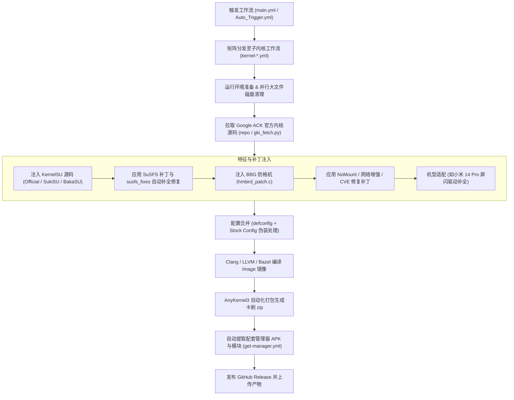

# GKI KernelSU SUSFS

**自动化构建 Android 通用内核 (GKI) | 深度集成 KernelSU + SUSFS + 安全与性能增强补丁**

[**English**](README-EN.md) | **简体中文**

---

## ⚠️ 核心兼容性与测试状态声明

> [!CAUTION]
> **重要测试状态说明：**
> - 本项目中的**绝大多数定制功能、增强补丁与编译修复**，目前**仅在 `Android 14 (6.1)` 内核与 `Android 12 (5.10)` 内核上面经过了实际的编译与真机运行验证**。
> - 对于其它内核版本（如 `Android 13 (5.15)`、`Android 15 (6.6)`、`Android 16 (6.12)` 等），由于 Google 上游代码树结构差异较大、符号变更频繁，**处于“未知是否能构建成功或正常开机”的状态**。
> - 如需在未经充分验证的内核版本上构建，请做好自行排查编译错误的准备，**刷入前请务必使用第三方 Recovery 或通过 fastboot 完整备份设备的 `boot` / `init_boot` 分区**！

---

## 📌 上游项目与鸣谢 (Upstream References)

本项目基于开源社区的大量杰出成果构建，特此向上游开发者致谢：

- **自动化构建基础**：[zzh20188/GKI_KernelSU_SUSFS](https://github.com/zzh20188/GKI_KernelSU_SUSFS)（原构建流水线与项目发起者）
- **官方 KernelSU**：[tiann/KernelSU](https://github.com/tiann/KernelSU)（基于内核的 Android Root 解决方案）
- **SuSFS 隐蔽系统**：[simonpunk/susfs4ksu](https://gitlab.com/simonpunk/susfs4ksu)（针对 Root 及敏感挂载的高强度伪装系统）
- **社区 KSU 变体**：
  - [SukiX-Team/SukiSU](https://github.com/SukiX-Team/SukiSU) 与 [SukiSU-Ultra](https://github.com/SukiSU-Ultra/SukiSU-Ultra)
  - BakaSU 变体
- **NoMount 挂载元模块**：[maxsteeel/nomount](https://github.com/maxsteeel/nomount)
- **防变砖/防格机方案**：BBG（`hmbird_patch.c` 底层关键分区写保护机制）
- **刷机包打包框架**：[osm0sis/AnyKernel3](https://github.com/osm0sis/AnyKernel3)
- **容器与底层环境**：[ravindu644/Droidspaces-OSS](https://github.com/ravindu644/Droidspaces-OSS)
- **安全修复链**：GhostLock 漏洞团队及 Linux 上游 rtmutex 修复补丁

---

## 🔄 本仓库的核心修改与优化 (What Changed)

相比原作者上游仓库，当前仓库进行了如下深度适配与改进：

### 1. 解除原作者账号硬编码与分发限制
- **去除身份判断门禁**：彻底去除了 `.github/workflows/main.yml` 与 `Auto_Trigger.yml` 中必须为原作者账号才允许发布 Release 和触发自动构建的硬编码限制，支持在 Fork 仓库下自主运行自动化工作流。
- **重定向资源拉取地址**：修正了 `get-manager.yml`、`build.yml` 中写死原作者仓库的下载链接，将旧版 APK、SUSFS 配套模块以及 `hmbird_patch.c` 的下载源对齐到本仓库（`Aut520/GKI_KernelSU_SUSFS`），解决了跨仓库构建时的 404 与网络拉取失败问题。

### 2. 开箱即用的最佳默认配置优化
为了兼顾系统安全性、稳定性和免配置便利性，仓库将默认参数调整为推荐的最佳实践组合：
- **默认 KernelSU 变体**：由原先的 `BakaSU` 改为 **`Official`**（官方原版内核模块，稳定性最高，与官方模块生态兼容性最佳）。
- **默认构建产物发布模式**：由仅生成内部 Artifact 的 `Actions` 调整为 **`Release`**（自动发布 GitHub Release，并附带对应变体的安装包与模块）。
- **默认启用推荐补丁链**：
  - `use_bbg: true`：默认开启 BBG 防格机保护；
  - `use_zram: true`：默认开启 ZRAM 增强算法；
  - `use_nomount: true`：默认开启 NoMount 内核挂载元模块；
  - `use_networking: true`：默认开启高级内核网络栈增强（BBRv3 等）；
  - `cve_2026_43499_patch: true`：默认开启 GhostLock 安全漏洞修补链。

### 3. 5.10 与 6.1 内核专项编译与补丁修复
- **5.10 Thin-LTO 内存保护**：上游全局移除了 Thin LTO 强制启用选项，但在 5.10 内核上使用 Full LTO 链接超大 `vmlinux.o` 时极易触发 GitHub Actions 内存溢出（OOM）被系统杀进程或超时。本仓库在 `build.yml` 中针对 5.10 内核精准恢复了 `LTO=thin`，保证 5.10 内核构建稳定通畅。
- **5.10 `preinit.c` 编译错误修复**：修复了在 5.10 内核下编译 SUSFS 时因头文件缺失导致缺少 `close_fd` 符号声明的报错。
- **`fs/namespace.c` 自动容错修复**：在 `scripts/susfs_fixes/apply.sh` 中增加了对 `fs/namespace.c` Hunk #1 官方补丁缺失声明的自动校准与补全兜底，避免官方补丁在新版 ACK 上失配。
- **构建时间实时化**：清理了工作流中写死 2024 年时间的遗留参数，恢复留空自动采用当前实时 UTC 构建时间。

---

## 🛠️ 功能特性与实现原理 (Features & Implementation)

| 功能特性 | 作用与优势 | 底层实现原理 |
| :--- | :--- | :--- |
| **KernelSU 多变体** | 提供官方原版 Official、SukiSU 以及 BakaSU 等多种实现方案 | 在 Bazel / Make 构建阶段将 KSU 源码注入内核源码树，通过注册内核钩子与系统调用接管权限控制。 |
| **SuSFS 深度隐蔽** | 隐藏 Root 进程、KSU 符号、自定义挂载点与驱动痕迹 | 内核级拦截 VFS 挂载点与路径遍历逻辑，重载 `openat` / `stat` / `readlink` 等系统调用，伪装敏感路径。 |
| **BBG 防格机保护** | 防御恶意模块执行 `dd` / `wipe` 清空手机底层分区 | 注入 `hmbird_patch.c`，在内核块设备驱动层设置白名单，拦截针对 `boot`、`super`、`userdata`、基带等分区的非法写指令。 |
| **NoMount 挂载元模块** | 无需创建用户态可见挂载点即可加载模块 | 基于 `maxsteeel/NoMount`，在内核 `fs/` 层直接拦截目标路径的 inode 重定向，绕过各类基于 mount 记录的安全检测。 |
| **ZRAM 增强与多压缩流** | 极大提升系统流畅度，降低高负荷下内存压缩耗时 | 修补内核 ZRAM 驱动，支持 ZSTD、LZ4 算法，开启多压缩流通道（Multi-Comp），与 Android 用户态 `mmd` 深度协作。 |
| **网络性能增强** | 优化弱网环境下的传输速率与网络排队能力 | 在内核配置中激活 BBRv3 拥塞控制算法、高级 IPSet 匹配规则、Qdisc 队列调度及 CIFS 协议支持。 |
| **GhostLock 安全修补** | 防御普通应用提权与内核级拒绝服务崩溃攻击 | 针对 `CVE-2026-43499` 与 `CVE-2026-53163`，修补 `kernel/locking/rtmutex.c` 锁竞争缺陷。 |
| **Stock Config 伪装** | 隐藏内核编译配置中的敏感 Root 标志 | 自动读取 `config/stock_<ver>.config`，在生成 `/proc/config.gz` 时替换为原厂出厂配置，使检测工具无法查出第三方宏。 |
| **小米 14 Pro 闪烁修复** | 解决升级高版本内核（>=6.1.140）后屏幕异常闪烁 | 运行 `fix_xiaomi_shennong_display.py`，合并小米官方开源显示驱动（`vendor_opensource_display-drivers`）的兼容性补丁。 |

---

## 🏗️ 自动化构建工作流程 (Build Architecture)

整个仓库的自动化构建基于 GitHub Actions，其全流程分为以下阶段：

1. **入口调度**：由 [`main.yml`](.github/workflows/main.yml) 或 [`Auto_Trigger.yml`](.github/workflows/Auto_Trigger.yml) 统一分发至各个内核版本的独立工作流（如 `kernel-a14-6-1.yml`）。
2. **环境准备与磁盘清理**：在 Ubuntu Runner 上并行清理多余预装工具链，腾出 40GB+ 磁盘空间供内核编译与 LLVM 链接使用。
3. **源码拉取**：调用 `scripts/gki_fetch.py` 或 AOSP repo manifest 获取指定 Android 安全补丁级别与 LTS 子版本的官方通用内核源码。
4. **特性修补**：按依赖顺序依次注入 KernelSU、SuSFS、`susfs_fixes/apply.sh` 符号兜底、NoMount、BBG 防格机、ZRAM 增强和 GhostLock 修复补丁。
5. **配置修补与伪装**：自动注入所需 Kconfig 选项，若存在 `config/stock_<ver>.config` 则启用出厂配置伪装。
6. **编译与打包**：使用 Google 官方预编译 Clang/LLVM 链通过 Bazel 或 Make 编译目标内核 `Image`，随后结合 AnyKernel3 自动打包生成兼容 Android GKI 的可卡刷 ZIP 文件。
7. **交付与发布**：调用 `get-manager.yml` 自动收集对应版本的管理器 APK、SUSFS 模块与 NoMount 模块，并在 Release 页面完整发布。

---

## 📖 刷入与使用指南

### 1. 刷入前准备
- 确认手机支持 **GKI 架构**（一般出厂搭载 Android 12 及以上系统的设备均支持）。
- 确认当前系统的内核主版本号（例如通过 `uname -r` 查看，`6.1.xxx` 对应 A14-6.1，`5.10.xxx` 对应 A12-5.10）。
- **必须备份 `boot` 与 `init_boot` 分区**！

### 2. 刷入方式
- **方式一（第三方 Recovery 卡刷）**：在 TWRP / OrangeFox 等 Recovery 中直接刷入生成的 `AnyKernel3-*.zip`。
- **方式二（Kernel Flasher / 类似工具）**：在已有 Root 的系统中使用 Kernel Flasher 直接刷入内核 ZIP 包。
- **方式三（解包刷入）**：解压 AnyKernel3 压缩包提取 `Image`，通过 fastboot 烧录进对应分区（具体依据机型分区设计而定）。

---

## 📄 许可证 (License)

本项目内核补丁与修改部分遵循 [GPL-2.0 许可证](LICENSE)，各上游组件版权归各自原作者所有。
